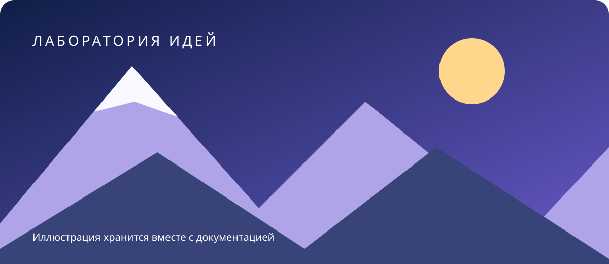
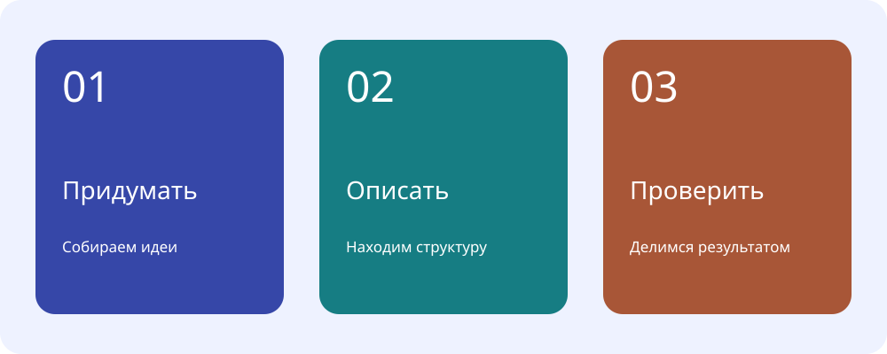

# Галерея лаборатории

## Остров на закате

*Вымышленный пейзаж. SVG хранится в репозитории и загружается с самого сайта.*

## От идеи до результата

Три простых действия: сформулировать мысль, сохранить её в документации и проверить результат.

## Вымышленные результаты месяца

| Показатель | Было | Стало |
| --- | ---: | ---: |
| Страницы журнала | 12 | 28 |
| Наблюдения | 37 | 64 |
| Снимки неба | 8 | 23 |
| Выпитые чашки чая | 90 | 142 |

!!! quote "Из журнала экспедиции"
    Вечером облака разошлись, и над перевалом показались первые звёзды. Мы выключили фонари и на минуту забыли про записи.

## Подписи к изображениям

Изображение должно дополнять текст. В альтернативном описании полезно написать, что именно на нём показано: это помогает читателям и делает страницу доступнее.

[Вернуться на главную](index.md) или [открыть путеводитель](guide.md).
